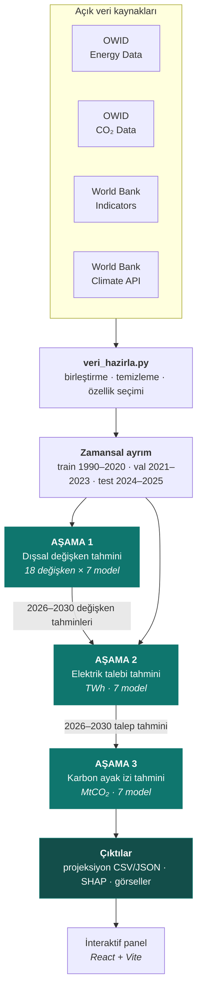

<div align="center">

# Makine Öğrenmesi ile Elektrik Tüketimi Tahmini ve Karbon Ayak İzi Analizi

**Üç aşamalı bir tahmin hattı, yedi model, tek soru:**<br/>
Türkiye 2030'da ne kadar elektrik tüketecek ve bunun karbon karşılığı ne olacak?

<br/>

[](https://www.python.org/)
[](https://www.tensorflow.org/)
[](https://scikit-learn.org/)
[](https://xgboost.readthedocs.io/)
[](https://optuna.org/)
[](https://shap.readthedocs.io/)

[](https://tubitak.gov.tr/)


<br/>

[Genel bakış](#genel-bakış) ·
[Mimari](#mimari) ·
[Veri](#veri) ·
[Yöntem](#yöntem) ·
[Sonuçlar](#sonuçlar) ·
[Kurulum](#kurulum) ·
[Sınırlılıklar](#sınırlılıklar) ·
[Ekip](#ekip)

</div>

---

## Genel bakış

Elektrik talebini tahmin etmek tek başına bir regresyon problemi değildir: talebi belirleyen
nüfus, gelir, kentleşme ve sanayi göstergelerinin kendileri de gelecekte bilinmez. Bu çalışma
problemi **birbirini besleyen üç aşamaya** ayırır — önce dışsal değişkenler tahmin edilir, sonra
bu tahminler elektrik talebi modeline girdi olur, en sonunda talep karbon salımına dönüştürülür.

Her aşamada aynı yedi model, aynı **walk-forward (genişleyen pencere)** çapraz doğrulama
noktalarında yarıştırılır. Böylece R² değerleri aşamalar arasında ve modeller arasında
doğrudan karşılaştırılabilir hale gelir.

> [!NOTE]
> Bu depo, Kocaeli Sağlık ve Teknoloji Üniversitesi'nde tamamlanan ve TÜBİTAK 2209-A
> programı kapsamında desteklenen bir lisans bitirme tezinin tüm kodunu, verisini ve
> çıktısını içerir. Tez savunulmuş ve tamamlanmıştır.

<table>
<tr>
<td width="25%" align="center"><b>0.9738</b><br/><sub>Aşama 2 · R²<br/>elektrik talebi</sub></td>
<td width="25%" align="center"><b>%2.57</b><br/><sub>Aşama 2 · MAPE<br/>ortalama hata</sub></td>
<td width="25%" align="center"><b>0.6615</b><br/><sub>Aşama 3 · R²<br/>karbon ayak izi</sub></td>
<td width="25%" align="center"><b>+%13.8</b><br/><sub>2026 → 2030<br/>öngörülen CO₂ artışı</sub></td>
</tr>
</table>

---

## Mimari



Aşama 1'in varlık sebebi tek bir kısıttır: 2030 elektrik talebini tahmin etmek için 2030
nüfusunu, gelirini ve kentleşme oranını da bilmek gerekir. Bu değişkenler ölçülemez, dolayısıyla
önce onlar tahmin edilir — ve bu tahminlerin belirsizliği zincir boyunca aşağı taşınır.

---

## Veri

| Kaynak | Kapsam | Alınan değişkenler |
|---|---|---|
| [OWID Energy Data](https://github.com/owid/energy-data) | 1990–2025 | elektrik talebi, birincil enerji, fosil/nükleer/yenilenebilir payları |
| [OWID CO₂ Data](https://github.com/owid/co2-data) | 1990–2025 | toplam CO₂, kömür/gaz kaynaklı CO₂, kişi başı CO₂ |
| [World Bank Indicators](https://data.worldbank.org) | 1990–2024 | GSYİH, nüfus, kentleşme oranı, sanayi katma değeri |
| World Bank Climate API | 1990–2024 | yıllık ortalama sıcaklık, sera gazı kaynaklı sıcaklık değişimi |

**Zamansal ayrım** — rastgele değil, kronolojik. Model gelecekteki hiçbir gözlemi görmez:

| Küme | Yıllar | Gözlem | Amaç |
|---|---|--:|---|
| `train.csv` | 1990–2020 | 4.772 | Model öğrenimi |
| `val.csv` | 2021–2023 | 596 | Hiperparametre araması |
| `test.csv` | 2024–2025 | 124 | Nihai değerlendirme |
| *(projeksiyon)* | 2026–2030 | — | Asıl hedef |

Ham veri 213 ülkeyi kapsar; modelleme Türkiye üzerinde yoğunlaşır. Nihai özellik seti
23 sütundan oluşur, bunların 18'i Aşama 1'de ayrı ayrı tahmin edilir.

<details>
<summary><b>Tahmin edilen 18 dışsal değişkenin tam listesi</b></summary>

<br/>

**Demografik** — `Population`, `Population_Density`, `Urbanization_Rate`

**Ekonomik** — `GDP_Per_Capita`, `GDP_Growth`, `Industry_Value_Added_Pct_GDP`

**Enerji** — `primary_energy_consumption`, `fossil_fuel_consumption`, `nuclear_consumption`,
`energy_per_capita`, `energy_per_gdp`, `fossil_share_elec`, `nuclear_share_elec`,
`renewables_share_elec`

**Emisyon ve iklim** — `coal_co2`, `gas_co2`, `co2_per_capita`, `temperature_change_from_ghg`

</details>

---

## Yöntem

### Yarıştırılan modeller

| # | Model | Tip | Girdi |
|--:|---|---|---|
| 1 | Random Forest | Topluluk (bagging) | özellik + gecikme |
| 2 | XGBoost | Topluluk (boosting) | özellik + gecikme |
| 3 | LightGBM | Topluluk (boosting) | özellik + gecikme |
| 4 | CatBoost | Topluluk (boosting) | özellik + gecikme |
| 5 | LSTM | Derin öğrenme (RNN) | özellik + gecikme |
| 6 | ARIMA | İstatistiksel | tek değişkenli |
| 7 | SARIMA | İstatistiksel | tek değişkenli, mevsimsel |

ARIMA ve SARIMA dışsal değişken kullanmaz; literatürde standart tek değişkenli
karşılaştırma tabanı (*baseline*) olarak yer alırlar.

### Değerlendirme

Tüm modeller aynı **genişleyen pencere** noktalarında değerlendirilir: model $t$ yılına kadarki
tüm veriyle eğitilir, $t+1$ tahmin edilir, pencere bir yıl genişletilir ve süreç tekrarlanır.

$$
R^2 = 1 - \frac{\sum_i (y_i - \hat{y}_i)^2}{\sum_i (y_i - \bar{y})^2}
\qquad
\mathrm{MAPE} = \frac{100}{n}\sum_{i=1}^{n}\left|\frac{y_i - \hat{y}_i}{y_i}\right|
$$

Ağaç tabanlı modeller ve LSTM için hiperparametreler **Optuna** ile aranır; değişken
katkıları **SHAP** ile ölçülür.

> [!IMPORTANT]
> **Sızıntı önlemi.** Aşama 3'te CO₂ türevi değişkenler (`coal_co2`, `gas_co2`,
> `co2_per_capita` …) hedefle doğrudan ilişkili oldukları için özellik setinden çıkarılır.
> Ayrıca her çapraz doğrulama katmanında ölçekleyici (*scaler*) yalnızca o katmanın eğitim
> verisine `fit` edilir — doğrulama verisi hiçbir aşamada ölçekleyiciyi görmez.

---

## Sonuçlar

### Aşama 2 ve 3 · Model karşılaştırması

<picture>
  <source media="(prefers-color-scheme: dark)" srcset="docs/assets/model-comparison-dark.png">
  <source media="(prefers-color-scheme: light)" srcset="docs/assets/model-comparison-light.png">
  
</picture>

Her iki aşamada da **LSTM** kazanır — ancak iki aşamanın zorluk seviyesi belirgin biçimde
farklıdır. Elektrik talebi neredeyse tamamen açıklanabilirken (R² ≈ 0.97), karbon salımı
aynı değişkenlerle yalnızca kısmen açıklanabilir (R² ≈ 0.66).

<table>
<tr><th align="left">Aşama 2 · Elektrik talebi (TWh)</th><th align="left">Aşama 3 · Karbon ayak izi (MtCO₂)</th></tr>
<tr valign="top"><td>

| Model | R² | MAE | MAPE |
|---|--:|--:|--:|
| **LSTM** | **0.9738** | **6.84** | **%2.57** |
| CatBoost | 0.9711 | 7.21 | %2.72 |
| XGBoost | 0.9698 | 7.36 | %2.76 |
| LightGBM | 0.9694 | 7.12 | %2.62 |
| Random Forest | 0.9666 | 7.79 | %2.95 |
| ARIMA | 0.9540 | 8.32 | %3.12 |
| SARIMA | 0.9490 | 8.99 | %3.36 |

</td><td>

| Model | R² | MAE | MAPE |
|---|--:|--:|--:|
| **LSTM** | **0.6615** | **19.47** | %4.60 |
| ARIMA | 0.6334 | 18.74 | **%4.37** |
| XGBoost | 0.6134 | 19.48 | %4.57 |
| Random Forest | 0.6124 | 20.29 | %4.77 |
| SARIMA | 0.5550 | 23.41 | %5.52 |
| LightGBM | 0.4753 | 22.64 | %5.28 |
| CatBoost | 0.4605 | 23.86 | %5.60 |

</td></tr>
</table>

> [!TIP]
> Aşama 3'te ARIMA'nın — hiçbir dışsal değişken kullanmadan — LSTM'e bu kadar yaklaşması
> tesadüf değildir. Karbon salımı güçlü bir trend bileşenine sahiptir ve tek değişkenli bir
> model bu trendi zaten yakalar. Ek değişkenlerin katkısı, elektrik talebinde olduğu kadar
> belirgin değildir.

### Aşama 1 · Hangi değişken ne kadar tahmin edilebilir?

<picture>
  <source media="(prefers-color-scheme: dark)" srcset="docs/assets/stage1-features-dark.png">
  <source media="(prefers-color-scheme: light)" srcset="docs/assets/stage1-features-light.png">
  
</picture>

Sonuç iki uçlu: nüfus, nüfus yoğunluğu ve kentleşme oranı gibi **atalet taşıyan** değişkenler
neredeyse kusursuz tahmin edilir (R² > 0.99). Buna karşılık `GDP_Growth` **hiçbir modelle
tahmin edilememiştir** (en iyi R² = −0.20) — yani en iyi model bile serinin ortalamasını
tahmin etmekten daha kötüdür. Büyüme oranı, doğası gereği ekonomik şoklara bağlı ve düşük
otokorelasyonlu bir seridir; bu bulgu bir başarısızlık değil, dürüst bir negatif sonuçtur.

### 2026–2030 karbon projeksiyonu

<picture>
  <source media="(prefers-color-scheme: dark)" srcset="docs/assets/carbon-projection-dark.png">
  <source media="(prefers-color-scheme: light)" srcset="docs/assets/carbon-projection-light.png">
  
</picture>

| Yıl | 2026 | 2027 | 2028 | 2029 | 2030 |
|---|--:|--:|--:|--:|--:|
| **LSTM (MtCO₂)** | 503.45 | 520.32 | 537.50 | 555.00 | 572.84 |
| Model aralığı | 493.7 – 523.9 | 502.2 – 561.0 | 508.3 – 598.1 | 515.4 – 635.1 | 522.2 – 672.1 |

Modeller arası makas 2026'da 30 MtCO₂ iken 2030'da 150 MtCO₂'ye çıkar. Bu genişleme,
projeksiyon ufku uzadıkça belirsizliğin nasıl biriktiğinin doğrudan bir ölçüsüdür ve
tek bir sayı yerine bir aralık raporlamanın gerekçesidir.

### Değişken katkıları (SHAP)

Türkiye'nin elektrik tüketimini açıklayan üç ana değişken:

| Değişken | Katkı |
|---|--:|
| Kişi başına GSYİH | %42 |
| Sanayi katma değeri | %18 |
| Nüfus | %14 |

---

## Kurulum

```bash
git clone --recurse-submodules \
  https://github.com/yavuzhankursun/Machine-Learning-Based-Electricity-Consumption-Forecasting-and-Carbon-Footprint-Analysis.git
cd Machine-Learning-Based-Electricity-Consumption-Forecasting-and-Carbon-Footprint-Analysis

python3 -m venv .venv && source .venv/bin/activate   # Windows: .venv\Scripts\activate
pip install -r requirements.txt
```

> [!WARNING]
> `dashboard/` bir git alt modülüdür. `--recurse-submodules` olmadan klonladıysanız
> `git submodule update --init --recursive` komutunu çalıştırın.

### Çalıştırma

```bash
# 1 — Veriyi hazırla (birleştirme, temizleme, zamansal ayrım)
python3 pipeline/veri/islenmis/veri_hazirla.py

# 2 — Üç aşamayı sırayla eğit
python3 pipeline/asama1_feature_tahmini/asama1_egit.py
python3 pipeline/asama2_elektrik_tahmini/asama2_egit.py
python3 pipeline/asama3_karbon_tahmini/asama3_egit.py

# 3 — Yedi modeli karşılaştır (aşamalar bağımsız çalıştırılabilir)
cd pipeline/model_karsilastirma
python3 asama1_karsilastirma.py   # ~25 dk · kesilirse kaldığı yerden devam eder
python3 asama2_karsilastirma.py   # ~2 dk
python3 asama3_karsilastirma.py   # ~2 dk
cd ../..

# 4 — README görsellerini yeniden üret
python3 docs/make_figures.py
```

<details>
<summary><b>Proje yapısı</b></summary>

<br/>

```
.
├── pipeline/                          ← Nihai üç aşamalı hat
│   ├── veri/
│   │   ├── ham/                       Dokunulmayan kaynak veri (OWID, World Bank)
│   │   └── islenmis/                  veri_hazirla.py + train/val/test ayrımı
│   ├── asama1_feature_tahmini/        18 dışsal değişkenin 2026–2030 tahmini
│   ├── asama2_elektrik_tahmini/       Elektrik talebi modeli (TWh)
│   ├── asama3_karbon_tahmini/         Karbon ayak izi modeli (MtCO₂) + SHAP
│   ├── model_karsilastirma/           7 model × 3 aşama ortak değerlendirme koşumu
│   └── sonuclar/                      Karşılaştırma çıktıları (CSV + JSON)
│
├── docs/
│   ├── make_figures.py                README görsellerini üretir (açık + koyu tema)
│   └── assets/                        Üretilen grafikler
│
├── dashboard/                         İnteraktif sonuç paneli (git alt modülü)
├── src/, src2/, collected/            İlk prototip koşumları — arşiv amaçlı korunuyor
├── output/, output2/                  Prototip çıktıları ve grafikleri
└── requirements.txt
```

> `src/`, `src2/`, `collected/`, `output/` ve `output2/` klasörleri projenin ilk iki
> yinelemesine aittir. Nihai sonuçlar **yalnızca** `pipeline/` altında üretilir; bu klasörler
> çalışmanın gelişim sürecini belgelemek için korunmuştur.

</details>

<details>
<summary><b>Belgeler</b></summary>

<br/>

| Dosya | İçerik |
|---|---|
| `elkitabi.html` | Veri sözlüğü ve değişken el kitabı |
| `arayuz.html` | Statik sonuç arayüzü |
| `pipeline/KLASOR_YAPISI.md` | Hat mimarisinin ayrıntılı açıklaması |
| `pipeline/model_karsilastirma/README.md` | Karşılaştırma koşumunun teknik notları |

> Tez metni, savunma sunumu ve TÜBİTAK proje formu bu depoda yayımlanmamaktadır.

</details>

---

## Sınırlılıklar

Bu çalışmanın bilinen ve açıkça raporlanan kısıtları:

- **Yıllık çözünürlük.** Veri yıllıktır; mevsimsel talep dalgalanmaları modellenemez.
  SARIMA'nın mevsimsel bileşeni bu nedenle kısıtlı kalmıştır (`D=0`).
- **Kısa seri.** 1990–2025 arası yalnızca 36 gözlem içerir. LSTM gibi yüksek kapasiteli
  modeller için bu, aşırı öğrenme riskini yapısal olarak yüksek tutar.
- **Zincirleme belirsizlik.** Aşama 2, Aşama 1'in tahminlerini gerçek değermiş gibi kullanır.
  Aşama 1'deki hata Aşama 2 ve 3'e taşınır; raporlanan aralıklar bu birikimi yansıtır.
- **`GDP_Growth` tahmin edilememiştir** (R² = −0.20). Bu değişkene dayanan çıkarımlar
  ihtiyatla değerlendirilmelidir.
- **Sabit politika varsayımı.** Projeksiyonlar mevcut enerji karması ve politika eğiliminin
  sürdüğünü varsayar; yapısal politika değişiklikleri modellenmemiştir.

---

## Ekip

<div align="center">

| Kişi | Rol |
|---|---|
| **Betül Canol** | Araştırmacı · TÜBİTAK 2209-A başvuru sahibi |
| **Yavuzhan Kurşun** | Araştırmacı |
| **Eren Yalaz** | Araştırmacı |
| **Dr. Yusuf Gürcan Şahin** | Danışman |

**Kocaeli Sağlık ve Teknoloji Üniversitesi**<br/>
Mühendislik ve Doğa Bilimleri Fakültesi

</div>

---

## Kaynakça

- Arslan, S. (2022). *A hybrid forecasting model using LSTM and Prophet for energy consumption
  with decomposition of time series data.* PeerJ Computer Science, 8, e1001.
  [doi:10.7717/peerj-cs.1001](https://doi.org/10.7717/peerj-cs.1001)
- Costantini, L., Laio, F., Mariani, M. S., & Ridolfi, L. (2024). *Forecasting national CO₂
  emissions worldwide.* Scientific Reports, 14, 22438.
  [doi:10.1038/s41598-024-73060-0](https://doi.org/10.1038/s41598-024-73060-0)
- Tian, L., Zhang, Z., He, Z., Yuan, C., Xie, Y., Zhang, K., & Jing, R. (2025). *Predicting
  energy-based CO₂ emissions in the United States using machine learning.* Sustainability,
  17(7), 2843. [doi:10.3390/su17072843](https://doi.org/10.3390/su17072843)

---

## Lisans ve atıf

Kod ve analizler akademik bir bitirme tezinin ürünüdür. Kullanılan açık veri setleri kendi
lisanslarına tabidir — [OWID](https://github.com/owid/energy-data) (CC BY 4.0) ve
[World Bank Open Data](https://data.worldbank.org) (CC BY 4.0).

Bu çalışmaya atıf yapmak isterseniz:

```bibtex
@thesis{canol2026elektrik,
  author      = {Canol, Betül and Kurşun, Yavuzhan and Yalaz, Eren},
  title       = {Makine Öğrenmesi ile Elektrik Tüketimi Tahmini ve
                 Karbon Ayak İzi Analizi},
  school      = {Kocaeli Sağlık ve Teknoloji Üniversitesi},
  year        = {2026},
  type        = {Bitirme Tezi},
  note        = {TÜBİTAK 2209-A Üniversite Öğrencileri Araştırma Projeleri
                 Destekleme Programı}
}
```

<div align="center">
<br/>
<sub>TÜBİTAK 2209-A Üniversite Öğrencileri Araştırma Projeleri Destekleme Programı kapsamında desteklenmiştir.</sub>
</div>
