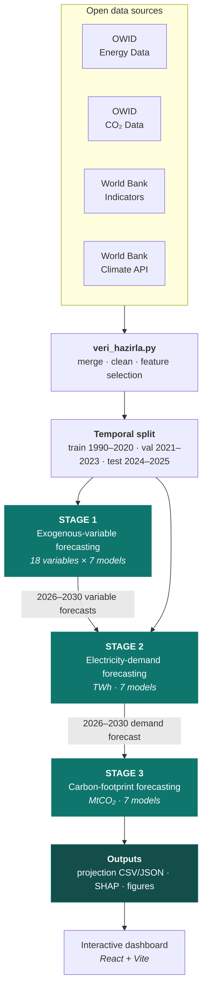
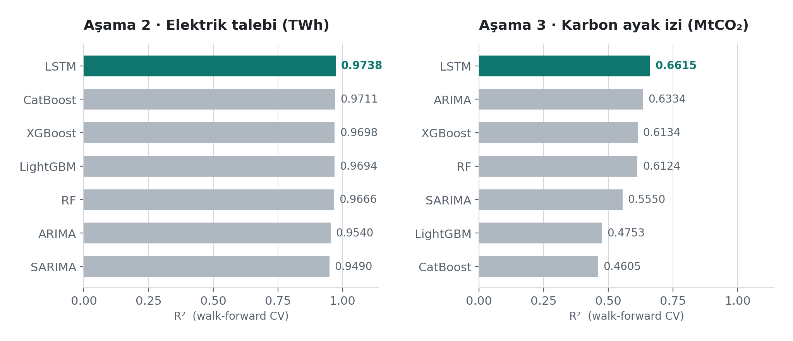
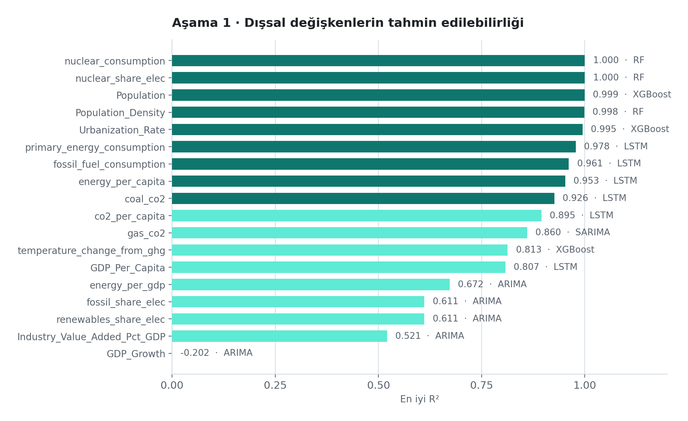
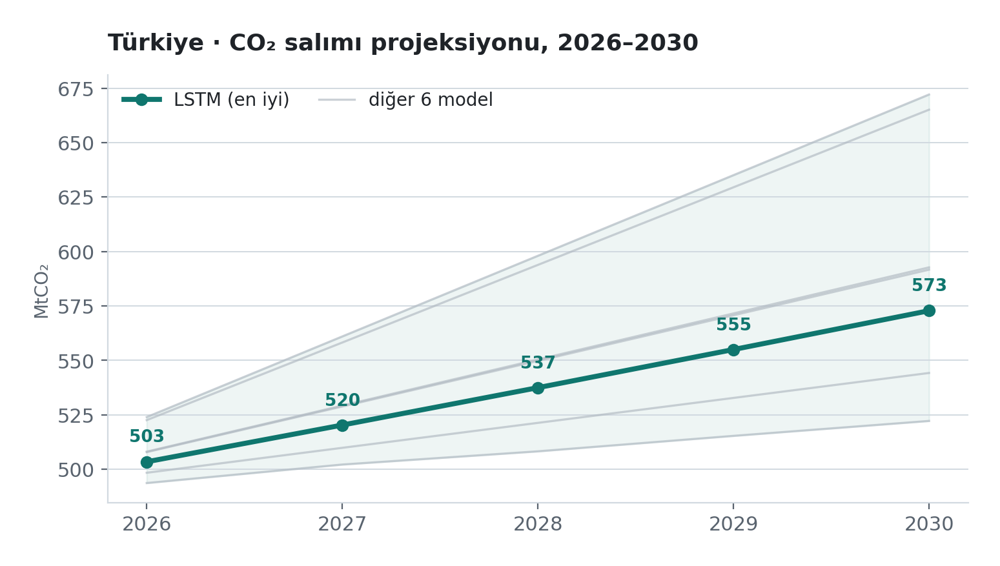

<div align="center">

# Machine Learning-Based Electricity Consumption Forecasting and Carbon Footprint Analysis

**A three-stage forecasting pipeline, seven models, one question:**<br/>
How much electricity will Türkiye consume in 2030, and what will its carbon cost be?

**English** | [Türkçe](README.tr.md)

<br/>

[](https://www.python.org/)
[](https://www.tensorflow.org/)
[](https://scikit-learn.org/)
[](https://xgboost.readthedocs.io/)
[](https://optuna.org/)
[](https://shap.readthedocs.io/)

[](https://tubitak.gov.tr/)


<br/>

[Overview](#overview) ·
[Architecture](#architecture) ·
[Data](#data) ·
[Method](#method) ·
[Results](#results) ·
[Setup](#setup) ·
[Limitations](#limitations) ·
[Team](#team)

</div>

---

## Overview

Forecasting electricity demand is not a single regression problem: the population, income, urbanization and industry indicators that drive demand are themselves unknown in the future. This study splits the problem into **three stages that feed each other**: first the exogenous variables are forecast, then those forecasts become inputs to the electricity-demand model, and finally demand is converted into carbon emissions.

At every stage the same seven models compete on the same **walk-forward (expanding-window)** cross-validation points. R² values are therefore directly comparable across stages and across models.

> [!NOTE]
> This repository contains all of the code, data and output of a bachelor's thesis completed at Kocaeli Health and Technology University and supported by the TÜBİTAK 2209-A programme. The thesis has been defended and completed.

<table>
<tr>
<td width="25%" align="center"><b>0.9738</b><br/><sub>Stage 2 · R²<br/>electricity demand</sub></td>
<td width="25%" align="center"><b>2.57%</b><br/><sub>Stage 2 · MAPE<br/>mean error</sub></td>
<td width="25%" align="center"><b>0.6615</b><br/><sub>Stage 3 · R²<br/>carbon footprint</sub></td>
<td width="25%" align="center"><b>+13.8%</b><br/><sub>2026 → 2030<br/>projected CO₂ increase</sub></td>
</tr>
</table>

---

## Architecture



Stage 1 exists because of a single constraint: to forecast electricity demand in 2030 you also need the population, income and urbanization rate of 2030. Those cannot be measured, so they are forecast first, and the uncertainty of those forecasts is carried down the chain.

---

## Data

| Source | Coverage | Variables taken |
|---|---|---|
| [OWID Energy Data](https://github.com/owid/energy-data) | 1990–2025 | electricity demand, primary energy, fossil/nuclear/renewable shares |
| [OWID CO₂ Data](https://github.com/owid/co2-data) | 1990–2025 | total CO₂, coal- and gas-sourced CO₂, CO₂ per capita |
| [World Bank Indicators](https://data.worldbank.org) | 1990–2024 | GDP, population, urbanization rate, industry value added |
| World Bank Climate API | 1990–2024 | mean annual temperature, temperature change from greenhouse gases |

**Temporal split**: chronological, not random. The model never sees a future observation:

| Set | Years | Observations | Purpose |
|---|---|--:|---|
| `train.csv` | 1990–2020 | 4,772 | Model training |
| `val.csv` | 2021–2023 | 596 | Hyperparameter search |
| `test.csv` | 2024–2025 | 124 | Final evaluation |
| *(projection)* | 2026–2030 | — | The actual target |

The raw data covers 213 countries; modeling focuses on Türkiye. The final feature set has 23 columns, 18 of which are forecast individually in stage 1.

<details>
<summary><b>Full list of the 18 forecast exogenous variables</b></summary>

<br/>

**Demographic** — `Population`, `Population_Density`, `Urbanization_Rate`

**Economic** — `GDP_Per_Capita`, `GDP_Growth`, `Industry_Value_Added_Pct_GDP`

**Energy** — `primary_energy_consumption`, `fossil_fuel_consumption`, `nuclear_consumption`,
`energy_per_capita`, `energy_per_gdp`, `fossil_share_elec`, `nuclear_share_elec`,
`renewables_share_elec`

**Emissions and climate** — `coal_co2`, `gas_co2`, `co2_per_capita`, `temperature_change_from_ghg`

</details>

---

## Method

### Competing models

| # | Model | Type | Input |
|--:|---|---|---|
| 1 | Random Forest | Ensemble (bagging) | features + lags |
| 2 | XGBoost | Ensemble (boosting) | features + lags |
| 3 | LightGBM | Ensemble (boosting) | features + lags |
| 4 | CatBoost | Ensemble (boosting) | features + lags |
| 5 | LSTM | Deep learning (RNN) | features + lags |
| 6 | ARIMA | Statistical | univariate |
| 7 | SARIMA | Statistical | univariate, seasonal |

ARIMA and SARIMA use no exogenous variables; they serve as the standard univariate baselines found in the literature.

### Evaluation

All models are evaluated on the same **expanding-window** points: the model is trained on all data up to year $t$, forecasts $t+1$, the window grows by one year, and the process repeats.

$$
R^2 = 1 - \frac{\sum_i (y_i - \hat{y}_i)^2}{\sum_i (y_i - \bar{y})^2}
\qquad
\mathrm{MAPE} = \frac{100}{n}\sum_{i=1}^{n}\left|\frac{y_i - \hat{y}_i}{y_i}\right|
$$

Hyperparameters of the tree-based models and the LSTM are searched with **Optuna**; variable contributions are measured with **SHAP**.

> [!IMPORTANT]
> **Leakage prevention.** In stage 3 the CO₂-derived variables (`coal_co2`, `gas_co2`, `co2_per_capita`, …) are removed from the feature set because they are directly related to the target. In addition, within every cross-validation fold the scaler is `fit` only on that fold's training data; the validation data never sees the scaler at any stage.

---

## Results

### Stages 2 and 3 · Model comparison

<picture>
  <source media="(prefers-color-scheme: dark)" srcset="docs/assets/model-comparison-dark.png">
  <source media="(prefers-color-scheme: light)" srcset="docs/assets/model-comparison-light.png">
  
</picture>

**LSTM** wins in both stages, but the two stages differ markedly in difficulty. Electricity demand is almost fully explainable (R² ≈ 0.97), whereas carbon emissions are only partly explainable with the same variables (R² ≈ 0.66).

<table>
<tr><th align="left">Stage 2 · Electricity demand (TWh)</th><th align="left">Stage 3 · Carbon footprint (MtCO₂)</th></tr>
<tr valign="top"><td>

| Model | R² | MAE | MAPE |
|---|--:|--:|--:|
| **LSTM** | **0.9738** | **6.84** | **2.57%** |
| CatBoost | 0.9711 | 7.21 | 2.72% |
| XGBoost | 0.9698 | 7.36 | 2.76% |
| LightGBM | 0.9694 | 7.12 | 2.62% |
| Random Forest | 0.9666 | 7.79 | 2.95% |
| ARIMA | 0.9540 | 8.32 | 3.12% |
| SARIMA | 0.9490 | 8.99 | 3.36% |

</td><td>

| Model | R² | MAE | MAPE |
|---|--:|--:|--:|
| **LSTM** | **0.6615** | **19.47** | 4.60% |
| ARIMA | 0.6334 | 18.74 | **4.37%** |
| XGBoost | 0.6134 | 19.48 | 4.57% |
| Random Forest | 0.6124 | 20.29 | 4.77% |
| SARIMA | 0.5550 | 23.41 | 5.52% |
| LightGBM | 0.4753 | 22.64 | 5.28% |
| CatBoost | 0.4605 | 23.86 | 5.60% |

</td></tr>
</table>

> [!TIP]
> It is no coincidence that ARIMA, using no exogenous variables at all, comes this close to the LSTM in stage 3. Carbon emissions have a strong trend component, and a univariate model already captures that trend. The added variables contribute less here than they do for electricity demand.

### Stage 1 · How predictable is each variable?

<picture>
  <source media="(prefers-color-scheme: dark)" srcset="docs/assets/stage1-features-dark.png">
  <source media="(prefers-color-scheme: light)" srcset="docs/assets/stage1-features-light.png">
  
</picture>

The result is two-sided: variables with **inertia**, such as population, population density and urbanization rate, are forecast almost perfectly (R² > 0.99). In contrast, `GDP_Growth` **could not be forecast by any model** (best R² = −0.20), meaning even the best model does worse than predicting the series mean. The growth rate is inherently shock-driven and weakly autocorrelated; this is not a failure but an honest negative result.

### 2026–2030 carbon projection

<picture>
  <source media="(prefers-color-scheme: dark)" srcset="docs/assets/carbon-projection-dark.png">
  <source media="(prefers-color-scheme: light)" srcset="docs/assets/carbon-projection-light.png">
  
</picture>

| Year | 2026 | 2027 | 2028 | 2029 | 2030 |
|---|--:|--:|--:|--:|--:|
| **LSTM (MtCO₂)** | 503.45 | 520.32 | 537.50 | 555.00 | 572.84 |
| Cross-model range | 493.7 – 523.9 | 502.2 – 561.0 | 508.3 – 598.1 | 515.4 – 635.1 | 522.2 – 672.1 |

The spread between models widens from 30 MtCO₂ in 2026 to 150 MtCO₂ in 2030. That widening is a direct measure of how uncertainty accumulates as the projection horizon grows, and it is the reason for reporting a range rather than a single number.

### Variable contributions (SHAP)

The three main variables explaining Türkiye's electricity consumption:

| Variable | Contribution |
|---|--:|
| GDP per capita | 42% |
| Industry value added | 18% |
| Population | 14% |

---

## Setup

```bash
git clone --recurse-submodules \
  https://github.com/yavuzhankursun/Machine-Learning-Based-Electricity-Consumption-Forecasting-and-Carbon-Footprint-Analysis.git
cd Machine-Learning-Based-Electricity-Consumption-Forecasting-and-Carbon-Footprint-Analysis

python3 -m venv .venv && source .venv/bin/activate   # Windows: .venv\Scripts\activate
pip install -r requirements.txt
```

> [!WARNING]
> `dashboard/` is a git submodule. If you cloned without `--recurse-submodules`, run `git submodule update --init --recursive`.

### Running

```bash
# 1 — Prepare the data (merge, clean, temporal split)
python3 pipeline/veri/islenmis/veri_hazirla.py

# 2 — Train the three stages in order
python3 pipeline/asama1_feature_tahmini/asama1_egit.py
python3 pipeline/asama2_elektrik_tahmini/asama2_egit.py
python3 pipeline/asama3_karbon_tahmini/asama3_egit.py

# 3 — Compare the seven models (stages can be run independently)
cd pipeline/model_karsilastirma
python3 asama1_karsilastirma.py   # ~25 min · resumes where it left off if interrupted
python3 asama2_karsilastirma.py   # ~2 min
python3 asama3_karsilastirma.py   # ~2 min
cd ../..

# 4 — Regenerate the README figures
python3 docs/make_figures.py
```

> Naming note: directory and script names in `pipeline/` are Turkish. `veri` = data, `asama` = stage, `egit` = train, `karsilastirma` = comparison, `sonuclar` = results.

<details>
<summary><b>Project structure</b></summary>

<br/>

```
.
├── pipeline/                          ← The final three-stage pipeline
│   ├── veri/
│   │   ├── ham/                       Untouched source data (OWID, World Bank)
│   │   └── islenmis/                  veri_hazirla.py + train/val/test split
│   ├── asama1_feature_tahmini/        2026–2030 forecasts of the 18 exogenous variables
│   ├── asama2_elektrik_tahmini/       Electricity-demand model (TWh)
│   ├── asama3_karbon_tahmini/         Carbon-footprint model (MtCO₂) + SHAP
│   ├── model_karsilastirma/           Shared 7-model × 3-stage evaluation run
│   └── sonuclar/                      Comparison outputs (CSV + JSON)
│
├── docs/
│   ├── make_figures.py                Generates the README figures (light + dark theme)
│   └── assets/                        Generated charts
│
├── dashboard/                         Interactive results dashboard (git submodule)
├── src/, src2/, collected/            Early prototype runs, kept for the record
├── output/, output2/                  Prototype outputs and charts
└── requirements.txt
```

> `src/`, `src2/`, `collected/`, `output/` and `output2/` belong to the first two iterations of the project. The final results are produced **only** under `pipeline/`; those directories are kept to document how the work evolved.

</details>

<details>
<summary><b>Documents</b></summary>

<br/>

| File | Content |
|---|---|
| `elkitabi.html` | Data dictionary and variable handbook |
| `arayuz.html` | Static results interface |
| `pipeline/KLASOR_YAPISI.md` | Detailed description of the pipeline architecture |
| `pipeline/model_karsilastirma/README.md` | Technical notes on the comparison run |

> The thesis text, the defense presentation and the TÜBİTAK project form are not published in this repository.

</details>

---

## Limitations

Known and explicitly reported constraints of this study:

- **Annual resolution.** The data is yearly; seasonal demand fluctuations cannot be modeled. SARIMA's seasonal component is therefore constrained (`D=0`).
- **Short series.** 1990–2025 contains only 36 observations. For high-capacity models such as LSTM this keeps the overfitting risk structurally high.
- **Chained uncertainty.** Stage 2 treats stage 1's forecasts as if they were actual values. Stage 1 error propagates into stages 2 and 3; the reported ranges reflect that accumulation.
- **`GDP_Growth` could not be forecast** (R² = −0.20). Any inference that depends on this variable should be treated with caution.
- **Constant-policy assumption.** The projections assume the current energy mix and policy trend continue; structural policy changes are not modeled.

---

## Team

<div align="center">

| Person | Role |
|---|---|
| **Betül Canol** | Researcher · TÜBİTAK 2209-A applicant |
| **Yavuzhan Kurşun** | Researcher |
| **Eren Yalaz** | Researcher |
| **Dr. Yusuf Gürcan Şahin** | Advisor |

**Kocaeli Health and Technology University**<br/>
Faculty of Engineering and Natural Sciences

</div>

---

## References

- Arslan, S. (2022). *A hybrid forecasting model using LSTM and Prophet for energy consumption with decomposition of time series data.* PeerJ Computer Science, 8, e1001. [doi:10.7717/peerj-cs.1001](https://doi.org/10.7717/peerj-cs.1001)
- Costantini, L., Laio, F., Mariani, M. S., & Ridolfi, L. (2024). *Forecasting national CO₂ emissions worldwide.* Scientific Reports, 14, 22438. [doi:10.1038/s41598-024-73060-0](https://doi.org/10.1038/s41598-024-73060-0)
- Tian, L., Zhang, Z., He, Z., Yuan, C., Xie, Y., Zhang, K., & Jing, R. (2025). *Predicting energy-based CO₂ emissions in the United States using machine learning.* Sustainability, 17(7), 2843. [doi:10.3390/su17072843](https://doi.org/10.3390/su17072843)

---

## License and citation

The code and analyses are the product of an academic bachelor's thesis. The open datasets used are subject to their own licenses: [OWID](https://github.com/owid/energy-data) (CC BY 4.0) and [World Bank Open Data](https://data.worldbank.org) (CC BY 4.0).

To cite this work:

```bibtex
@thesis{canol2026elektrik,
  author      = {Canol, Betül and Kurşun, Yavuzhan and Yalaz, Eren},
  title       = {Makine Öğrenmesi ile Elektrik Tüketimi Tahmini ve
                 Karbon Ayak İzi Analizi [Machine Learning-Based Electricity
                 Consumption Forecasting and Carbon Footprint Analysis]},
  school      = {Kocaeli Sağlık ve Teknoloji Üniversitesi},
  year        = {2026},
  type        = {Bachelor's Thesis},
  note        = {TÜBİTAK 2209-A University Students Research Projects
                 Support Programme}
}
```

<div align="center">
<br/>
<sub>Supported by the TÜBİTAK 2209-A University Students Research Projects Support Programme.</sub>
</div>
